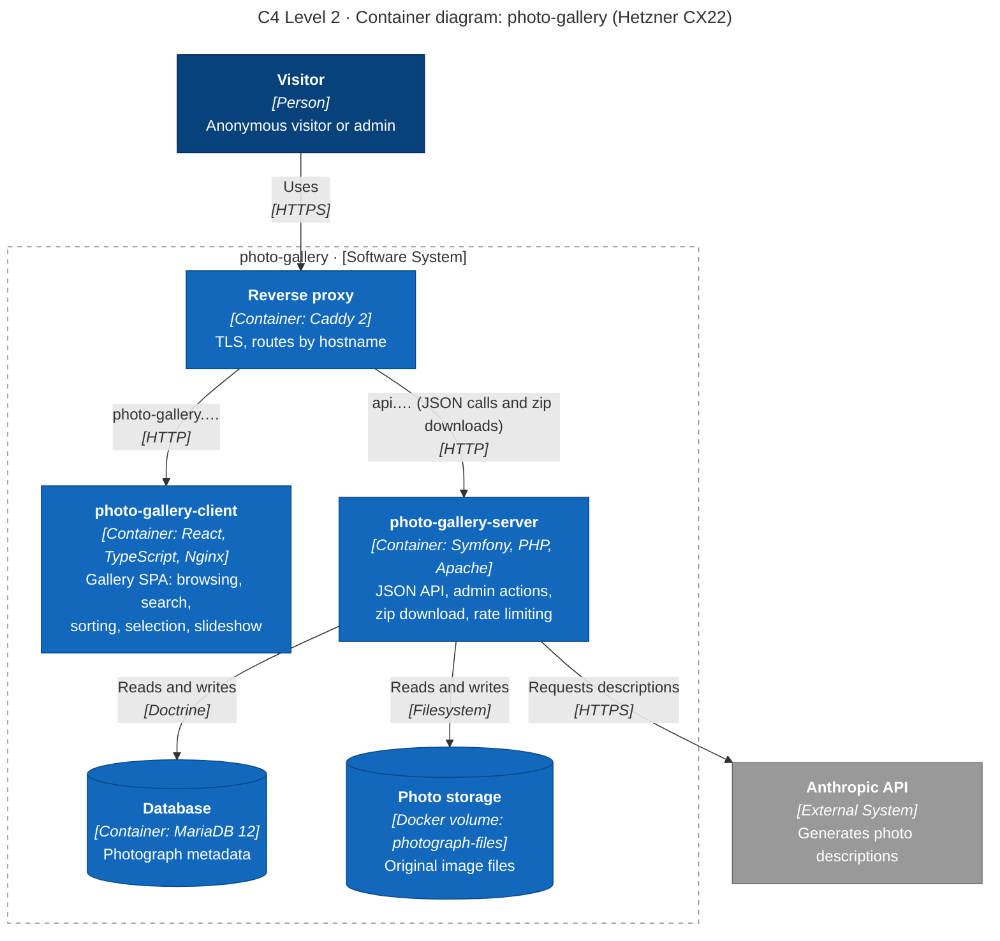
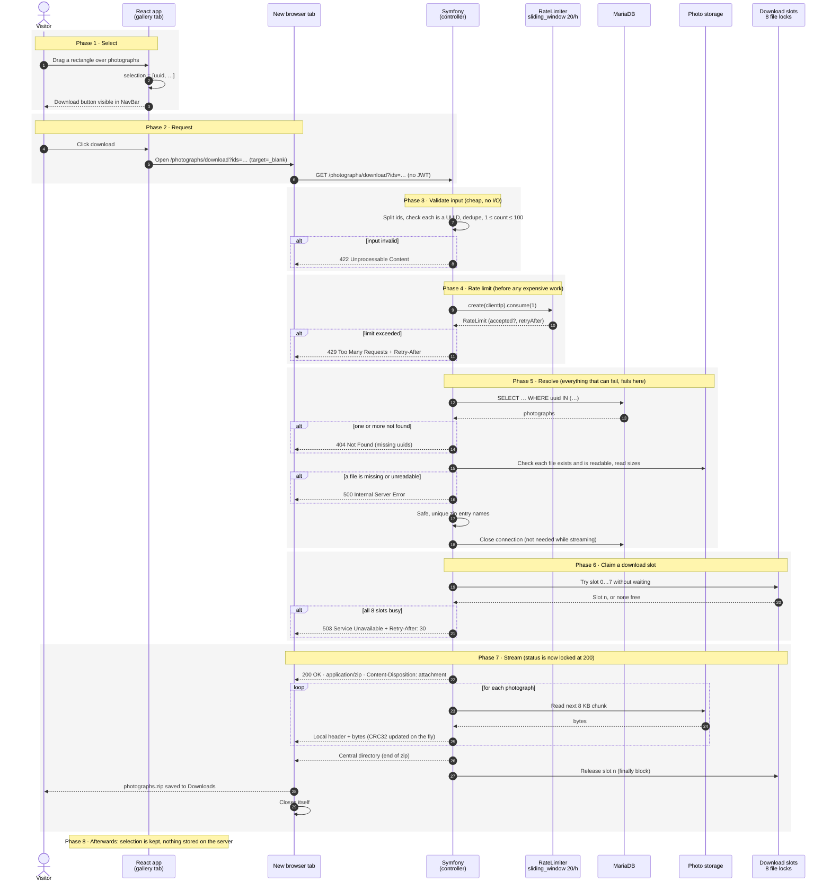

# Photograph download

Download a selection of photographs as a single zip file.

| | |
|---|---|
| **Status** | Built |
| **Repos** | `photo-gallery-server` (endpoint, Apache config), `photo-gallery-client` (download link), `photo-gallery-deploy` (no changes) |
| **Access** | Public: no JWT needed, same as the image files themselves |

## Summary

A visitor selects photographs with the rectangular selection. A download button appears in the NavBar. Clicking it opens one `GET` request in a new tab. The server validates the request, charges it against a per-IP rate limit (20 downloads per sliding hour), claims one of 8 global download slots, and streams a zip back. The zip is never written to disk or held in memory on the server.

```
GET /photographs/download?ids=<uuid>,<uuid>,…
```

## Decisions

| Decision | Choice | Rejected alternatives |
|---|---|---|
| Where the zip is built | Server, one request | 1 request per photograph (kernel boot ×N, browser multi-download prompt); zipping in the browser with JSZip (whole archive in browser memory) |
| How the zip is built | Streamed with `maennchen/zipstream-php`, `STORE` (no compression) | `ZipArchive` + temp file (disk use, orphan files on abort, first byte only after the whole zip is built); deflate (JPEGs don't compress, wasted CPU) |
| Request shape | `GET` with `ids` in the query string, opened in a new tab | `POST` + signed URL; `fetch` + `Blob` (whole zip in browser memory); async export job (worker, storage, polling, cleanup: far more machinery than the problem needs) |
| Authentication | None: the route is `PUBLIC_ACCESS` | Requiring the anonymous JWT. A navigation in a new tab cannot send an `Authorization` header, and the token protects nothing: anyone gets one from `GET /api/login/anonymous`, and the image files are already served without auth from `public/images` |
| Stored state | None, except the rate limiter's counter | `PhotographDownload` table (state that the URL can carry itself) |
| Selection cap | 100 photographs per request | No cap (unbounded URL length and response size) |
| Rate limit | `sliding_window`, 20 downloads per hour per client IP, every request counts | Counting only distinct selections (re-downloading one selection would be unlimited); `fixed_window` (2× the limit around a window boundary); a hand-written counter (race condition under parallel requests) |
| Concurrency | At most 8 downloads streaming at once, server-wide; the 9th gets `503` | No cap (the rate limit allows 20 at once per IP, enough to fill half the workers); Symfony Semaphore (needs Redis, which the stack doesn't have) |
| Apache workers | `MaxRequestWorkers 40`, `Timeout 60` | Debian defaults `150` and `300` (150 processes don't fit in 4 GB; a stalled client holds a worker for 5 minutes) |

## Architecture: C4 Level 2 (containers)

This diagram shows *structure*: which runnable parts exist and who talks to whom. It describes the whole project, so it belongs in the README; the download feature adds only the direct path from the visitor's browser to the server. It is drawn as a flowchart using C4's notation, because Mermaid's native C4 support is experimental and cannot route the arrows legibly.



## Workflow: UML sequence diagram

This diagram shows *behaviour*: one download, from selection to saved file, including every way it can end. Caddy is left out; it passes requests and responses through unchanged.



## Phases

### Phase 1: Select (client)

The rectangular selection fills the selection state with photograph UUIDs. When it holds at least one, the NavBar shows a download button. This works for every visitor, so the permission to *select* must not be tied to the permission to *delete*: each action decides for itself whether it is shown.

Above 100 selected photographs the link is replaced by a short message ("Select at most 100 photographs to download"). The selection is never silently cut. The 100 lives in both repos, each with a comment pointing to the other: `DownloadInputDTO::MAX_PHOTOGRAPHS` on the server (the real limit) and `MAX_PHOTOGRAPHS_PER_DOWNLOAD` in the client's `src/api/photographDownload.ts`.

### Phase 2: Request (client)

`PhotographSelectionDownloadLink` builds the URL with `createPhotographDownloadUrl()` and renders `<a href={url} target="_blank" rel="noopener">`.

- **Why a new tab:** the browser *navigates* to this URL. A `200` with `Content-Disposition: attachment` becomes a download and the tab closes itself. Any error has nothing to download, so the browser shows it as a page. In the same tab that would replace the React app and lose the selection; in a new tab the app survives.
- **No JWT.** A navigation cannot send an `Authorization` header, which is why the route is public.
- **No `fetch`, no `Blob`, no spinner.** The browser's own download bar shows progress and writes straight to disk.
- **URL length:** 100 UUIDs × 37 characters ≈ 3.7 KB, under Apache's ~8 KB request-line limit. The cap is what keeps this true.

### Phase 3: Validate input (server)

`DownloadInputDTOResolver` splits `ids` on commas, trims and lowercases each value, and drops empty values and duplicates. The validator (`config/validator/validation.yaml`) then requires 1 to 100 values, each a valid UUID. On failure: `422`, with the maximum in the message. This phase does no I/O, so rejecting bad input here is nearly free.

### Phase 4: Rate limit (server)

Consume one token from the limiter keyed by `$request->getClientIp()`. On rejection: `429` with a `Retry-After` header from `$limit->getRetryAfter()`.

- **Why here:** after validation, so a malformed request does not cost the visitor a download; before the database and file checks, so a visitor who is over the limit costs the server almost nothing.
- **Consequence:** a request that later fails (`404`, `503`) has still used a token. That is intended, otherwise someone could probe UUIDs without limit.
- **How `sliding_window` counts:** Symfony keeps two counters, the current hour window and the previous one. The estimate is `previous × (fraction of the previous window still inside the last 60 minutes) + current`. That removes the `fixed_window` flaw (20 at 14:59 plus 20 at 15:00) without storing a timestamp per request.
- **Requires `trusted_proxies`:** behind Caddy, see [Client IP behind Caddy](#client-ip-behind-caddy).

### Phase 5: Resolve (server)

`GetByUuidsQuery` loads all photographs with one `WHERE uuid IN (…)` query; if any are missing, `404` listing them. Then the archive entry `Factory` checks that every source file exists and is readable (`500` otherwise), reads the sizes, and builds the zip entry names from the titles:

- **Safe:** strip path separators and control characters, so a title like `../../x` cannot become a zip-slip path for whoever extracts the archive.
- **Unique, ignoring case:** `Sunset.jpg`, `sunset (2).jpg`. Most desktops compare file names case-insensitively, so these would otherwise overwrite each other on extraction.
- **Never empty:** a title with nothing left after sanitising falls back to the stored file name.

Finally close the database connection (`$entityManager->getConnection()->close()`). Streaming needs only the file paths, and an idle connection held for the length of a download wastes one of MariaDB's connections.

### Phase 6: Claim a download slot (server)

The rate limit counts downloads per hour; it does not limit how many run *at the same time*. With 40 Apache workers, one IP starting its 20 allowed downloads at once would occupy half the server, and two IPs all of it, so browsing would queue behind downloads.

So at most **8 downloads stream at once, server-wide**:

- `PhotographDownloadSlots` creates 8 locks with `symfony/lock`, named `photograph-download-slot-0` … `-7`.
- Try each with `acquire(false)` (don't wait). The first success is this request's slot.
- If all 8 fail: `503 Service Unavailable` with `Retry-After: 30`.
- The lock object is captured by the streaming callback and released in a `finally` block when streaming ends.
- The default lock store uses file locks (`flock`). If a PHP process crashes, the kernel releases its locks, so a slot can never leak permanently.

Why this phase comes after Phase 5: the slot guards only the expensive part. Every error exit happens before a slot is held, so no error path has to remember to release one.

### Phase 7: Stream (server → browser)

`ZipStreamResponseFactory` returns a `StreamedResponse` with `Content-Type: application/zip`, `Content-Length` and `Content-Disposition: attachment; filename=photographs.zip`. Inside the callback, zipstream-php writes for each photograph a local header and then the file in chunks, updating the CRC32 as it goes; the central directory comes last. Server memory stays flat regardless of selection size.

- **Content-Length** comes from a first, simulated pass over the same `ZipStream` (`OperationMode::SIMULATE_STRICT`), which is possible because entries are stored uncompressed and their sizes are known. The browser shows real progress and marks a cut-off download as failed instead of complete.
- Once the first byte is sent, the status is fixed at `200`. A failure now produces a truncated zip.
- The slot is released in a `finally` block, so a failed stream frees it too.

### Phase 8: Afterwards

The selection stays. The server stores nothing about the download; only the limiter's counter for this IP exists, and it expires on its own.

## Implementation

| Layer | Class | Responsibility |
|---|---|---|
| Presentation | `Action\Photograph\DownloadAction` | Runs phases 3 to 7 in order; every early return happens before streaming |
| Presentation | `DTO\Photograph\DownloadInputDTO` | The requested uuids; owns `MAX_PHOTOGRAPHS = 100` |
| Presentation | `Resolver\Photograph\DownloadInputDTOResolver` | Parses `?ids=`: trim, lowercase, drop empty values and duplicates |
| Presentation | `Response\JsonErrorResponse` | The API's `{"errors": "..."}` body, also built from validator violations |
| Application | `Query\Photograph\GetByUuidsQuery` + `Handler\Photograph\GetByUuidsHandler` | Finds the photographs that exist; unknown uuids are simply absent |
| Application | `Archive\ArchiveEntry` | Name inside the archive, path on disk, size |
| Application | `Factory\ArchiveEntry\Factory` | Readable-file check, safe and unique names |
| Infrastructure | `Doctrine\Repository\PhotographRepository::findByUUIDs()` | One `WHERE uuid IN (…)` query |
| Infrastructure | `Symfony\Lock\PhotographDownloadSlots` | 8 non-blocking flock slots |
| Infrastructure | `ZipStream\ZipStreamResponseFactory` | Simulated pass for `Content-Length`, real pass inside the response |

Client: `src/api/photographDownload.ts` (URL and the 100), `src/components/PhotographSelectionDownloadLink/` (the link or the over-limit message), rendered by `NavBar` for every visitor.

## Configuration

| File | What it does |
|---|---|
| `config/routes.yaml` | `photograph_download` route; every `{id}` route now requires a UUID, so `/photographs/download` can never match `GET /photographs/{id}` and malformed ids are rejected by the router with `404` |
| `config/packages/security.yaml` | `^/photographs/download$` is `PUBLIC_ACCESS`, above the `^/photographs` rule (first match wins). The `main` firewall stays stateless, so no PHP session can lock a visitor's other requests during a long download |
| `config/validator/validation.yaml` | `Count(1..100)` and `All(Uuid)` on `DownloadInputDTO` |
| `config/packages/rate_limiter.yaml` | `photograph_download`: `sliding_window`, 20 per 60 minutes, stored in `cache.rate_limiter` (filesystem) |
| `config/packages/lock.yaml`, `.env` | `LOCK_DSN=flock`, as the `symfony/lock` recipe writes it |
| `config/packages/framework.yaml` | `trusted_proxies: private_ranges`, see below |
| `docker/apache/mpm_prefork.conf`, `docker/apache/photo-gallery.conf`, `docker/Dockerfile` | `MaxRequestWorkers 40`, `Timeout 60`, `ServerName localhost`, copied in the `php-base` stage so dev and prod match |
| `composer.json` | `extra.symfony.require` corrected from `7.3.*` to `8.1.*`; Flex uses it to restrict Symfony package versions |

### Client IP behind Caddy

In production Caddy proxies every request to Apache, so without trusted proxies `$request->getClientIp()` returns **Caddy's container IP** for every visitor, and all visitors share one rate-limit bucket.

- With `trusted_proxies: 'private_ranges'` Symfony reads the visitor's IP from `X-Forwarded-For`, which Caddy sets.
- Trusting all private ranges is safe **only because** `photo-gallery-deploy` exposes the server on the Docker network alone (`expose`, no `ports`). Nothing outside can reach Apache directly and forge the header.
- `photo-gallery-server`'s own `compose.prod.yaml` still publishes `9000:80`. If that file is ever used in production, this trust becomes spoofable. Remove the port or the file.

### Apache

- **Why 40 workers:** the number of busy workers is roughly requests per second × how long each request takes. An API call takes ~50 ms; a download ~20 s, about 400× longer. The ceiling must be what fits in RAM: on a 4 GB CX22, after the OS, MariaDB, Nginx and Caddy, about 2.5 GB is left; at ~50 MB per process that is ~50. Above the ceiling Apache queues requests; without it the kernel's out-of-memory killer kills the largest process, usually MariaDB.
- **Confirm the 50 MB** after some requests: `docker compose exec server ps -o rss,cmd -C apache2` (RSS in KB).
- **Why `Timeout 60`:** Debian's `apache2.conf` sets 300. A client that stops reading mid-download would hold a worker for 5 minutes. `conf-enabled` is loaded after that line, so this value wins.
- **8 slots out of 40 workers** leaves 32 for browsing, whatever downloads do.

### Verified environment

| Check | Result |
|---|---|
| PHP version | 8.5.11, 64-bit. zipstream-php 3.2 needs ≥ 8.3 |
| `max_execution_time` (web) | 30. Counts CPU time, not waiting on the network. Streaming 500 MB costs a few seconds of CPU. Test without Xdebug (dev only) |
| `output_buffering` | 4096 in both `php.ini-development` and `php.ini-production`. Harmless: PHP sends output every 4 KB on its own |
| `zlib.output_compression` | Off in both ini files |
| `memory_limit` | 128M. Streaming uses a few MB |
| Apache `mod_deflate` | Loaded, but its type list excludes `application/zip` |
| Caddy `encode` | Not configured, so no compression |
| Firewalls | `login` and `main` both `stateless: true` |

## Tests

| Test | Covers |
|---|---|
| `tests/Application/Photograph/DownloadActionTest` | End to end without a token: a valid zip whose entries match the source files and whose size matches `Content-Length`; `422` for missing, empty, malformed and over-limit selections; `404` listing unknown uuids; `500` before streaming for a missing file; `429` with `Retry-After` on the 21st request; separate limits per `X-Forwarded-For` IP; `503` with `Retry-After: 30` when all slots are held; the slot is free again after streaming |
| `tests/Unit/Application/Factory/ArchiveEntry/FactoryTest` | Path traversal, backslashes, Windows-forbidden and control characters, leading and trailing dots, non-ASCII kept, fallback name, no extension, case-insensitive numbering, missing file |
| `tests/Unit/Infrastructure/ZipStream/ZipStreamResponseFactoryTest` | Stored entries, exact `Content-Length`, nothing streamed before sending, `afterStreaming` runs on success and on failure |
| `tests/Unit/Infrastructure/Symfony/Lock/PhotographDownloadSlotsTest` | Real flock store: every slot handed out once, `null` when all are taken, a released slot can be claimed again |
| `DownloadInputDTOResolverTest`, `GetByUuidsHandlerTest`, `JsonErrorResponseTest`, `PhotographRepositoryTest::canFindByUUIDsSkippingUnknownOnes`, `GetOneActionTest::returnsNotFoundForAnIdThatIsNotAUuid` | The remaining classes and the route requirement |

The limiter keeps its counters in a filesystem cache that outlives a test, so `DownloadActionTest` clears `cache.rate_limiter` in `setUp()`. An in-memory cache does not work here: Symfony resets in-memory services between requests, even with kernel reboot disabled.

## Known limitations and technical debt

- **Per-IP is a speed bump, not a wall.** It stops one script and careless repeat clicks. It does not stop someone with many IPs, and visitors behind one shared IP (office or mobile carrier NAT) share one budget.
- **Rate-limit counters reset on every deploy.** They live in Symfony's cache, which the container rebuilds at start-up.
- **A `503` still costs a rate-limit token.** Rare (only when 8 downloads are already streaming), accepted.
- **Error pages in the new tab are raw JSON.** Optional polish: return a minimal HTML page when the request's `Accept` header prefers `text/html`.
- **Race between phase 5 and phase 7:** a photograph deleted by an admin during streaming produces a truncated zip. With `Content-Length` set, the browser reports it as failed. The window is milliseconds to seconds; accepted.

## Related work (separate commits, not part of this feature)

- **Login throttling:** add `login_throttling: { max_attempts: 5, interval: '15 minutes' }` to the `login` firewall. Uses the same `symfony/rate-limiter` package.
- **`423` → `403`:** create, delete and generate-description deny access with `423 Locked`, a WebDAV status meaning "resource is locked". "Not allowed" is `403`.
- **`GenerateDescriptionAction`** builds the same `{"errors": ...}` body from violations by hand; it can use `JsonErrorResponse::fromViolations()` instead.

## Scaling path (not built)

If downloads ever need to exceed the cap (for example "download all 5,000"), switch to an async export: `POST /exports` dispatches a Messenger message, a worker builds the zip to storage, the client polls, then downloads through a short-lived signed URL. On AWS this maps onto SQS + S3 presigned URLs.
